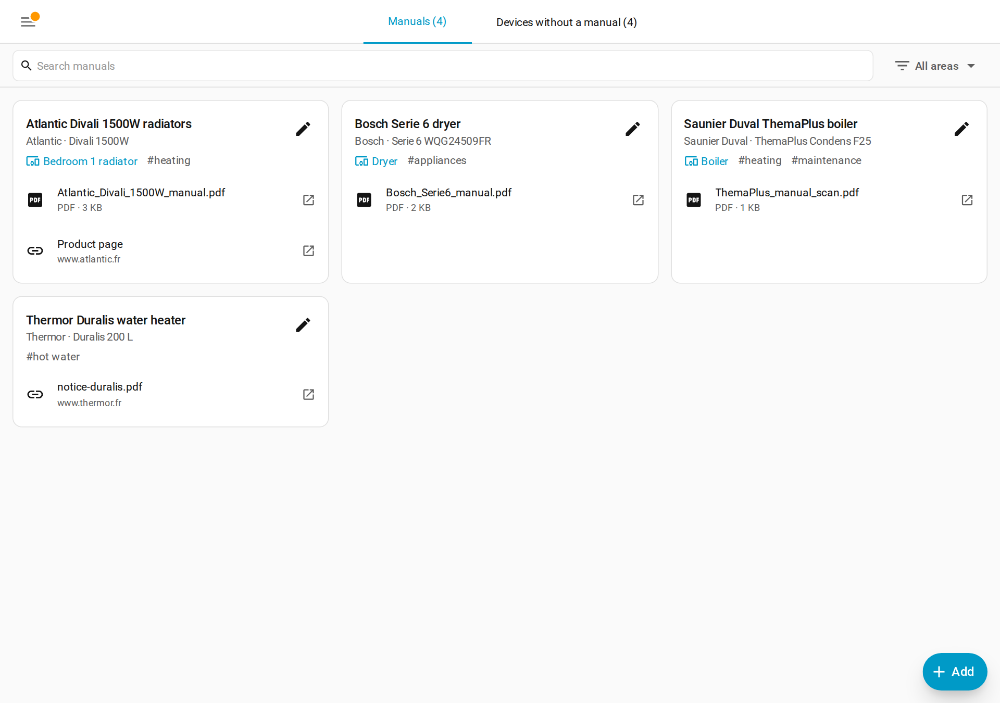
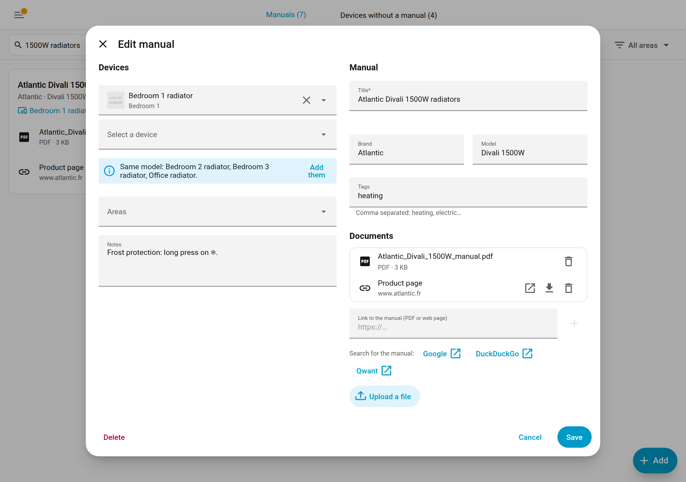
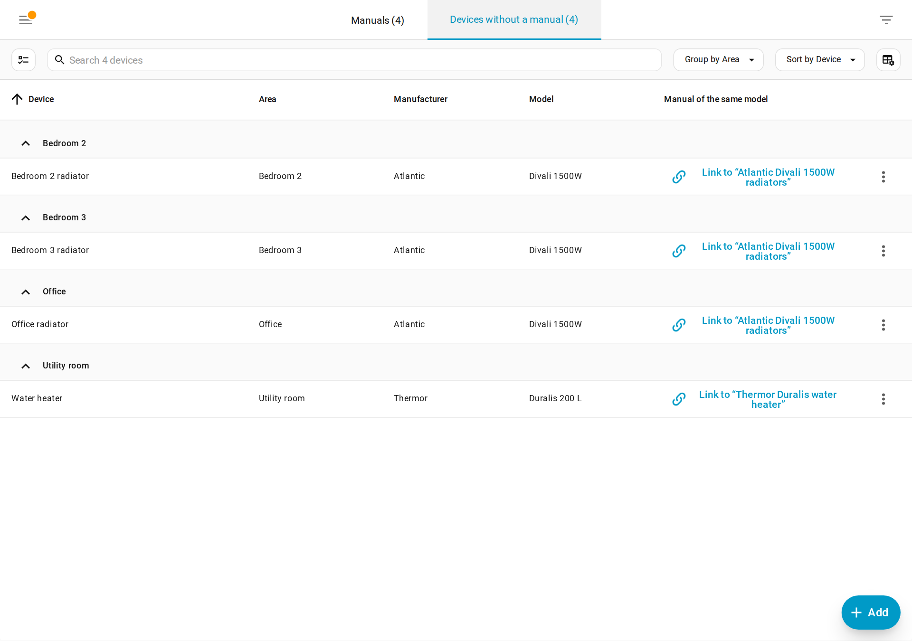
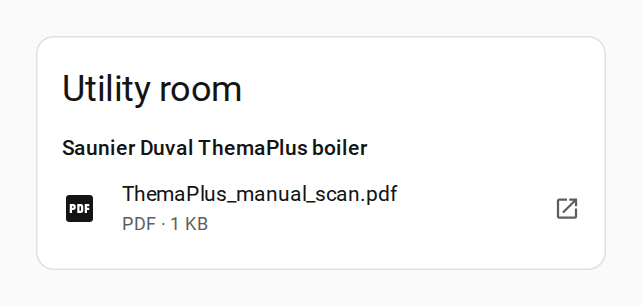
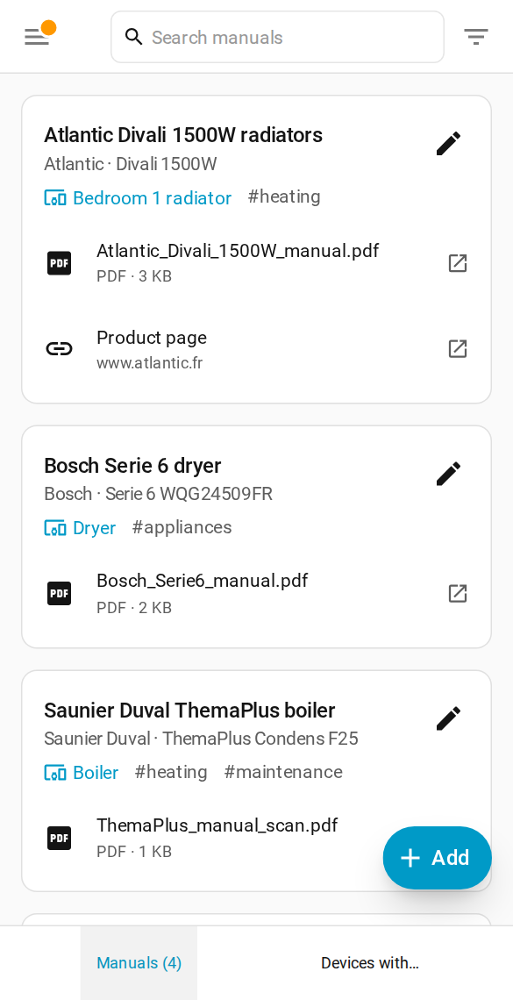

# Manuals for Home Assistant

A Home Assistant integration to store, browse and search the manuals of your appliances: radiators, household appliances, boiler… Manuals are linked to Home Assistant devices and areas, and can be opened from a dedicated panel or a dashboard card.



## Features

### Manuals linked to your home

A manual has a title, a brand, a model, tags, notes and documents. It can be linked to several devices and several areas: a single manual for four identical radiators, for instance. A manual without any Home Assistant device (a water heater that is not connected…) can still be browsed.

Documents are either:

- **files** uploaded from the form (PDF or PNG, JPEG, GIF, WebP images, up to 100 MB), stored in `<config>/manuals/` and therefore included in Home Assistant backups. The type is checked from the content of the file, whatever its name;
- or **links** to documents hosted elsewhere, opened in a new tab.

### Manuals panel

The sidebar panel lists every manual. Search covers the title, brand, model, tags and notes, the names of the linked devices and areas (including the areas of these devices) and the names and addresses of the documents (not their content), ignoring case and accents. A menu filters by area (a manual belongs to an area when it is linked to the area or to one of its devices).

Every user can browse manuals; only administrators can create, edit or delete them.

### Form



- **Pre-filling**: when a device is picked first, the brand, model and title are taken from the device.
- **Same model**: the form offers to add the other devices of the same brand and model.
- **Web search for the manual**: links open Google, DuckDuckGo or Qwant with a pre-filled search ("Atlantic Divali 1500W user manual filetype:pdf"). No API key is needed.
- **Local copy of a link**: when a link is pasted, Home Assistant checks what it points to. If it is a PDF or an image, it can keep a copy (checked by default), which stays available if the manufacturer's website removes it. A web page is kept as a plain link. A link already saved can also be copied later.

### Devices without a manual



A second tab, for administrators, lists in a table the Home Assistant devices that have no manual yet, grouped by area:

- **Link to "…"** when a manual already exists for the same brand and model;
- **Add a manual** (click on the row): the form opens, pre-filled with the device;
- **Ignore** the devices that need no manual (hubs, phones…).

Multi-selection links, ignores or creates a manual for several devices at once. Ignored devices and devices without brand or model (usually virtual ones) are hidden by default; the menu in the top right corner shows them.

### Dashboard card



The "Manuals" card is available in the card picker and set up with the visual editor: all manuals, the manuals of a device, or the manuals of an area (including its devices). In YAML:

```yaml
type: custom:manuals-card
device_id: 1234abcd…   # or entity: climate.bedroom_radiator, or area: kitchen
title: Radiator        # optional
```

Without `device_id`, `entity` or `area`, the card shows every manual.

### On mobile



The panel and the form are built with Home Assistant's own UI elements and adapt to small screens like the rest of the app.

## Installation

Tested with Home Assistant 2026.10.

### With HACS

1. HACS > ⋮ > **Custom repositories**.
2. URL: `https://github.com/a-legrand/ha-manuals`, category **Integration**.
3. Install "Manuals", then restart Home Assistant.
4. **Settings > Devices & services > Add integration > Manuals**.

### Manually

1. Copy `custom_components/manuals` into the `custom_components` folder of your Home Assistant configuration.
2. Restart Home Assistant, then add the "Manuals" integration as above.

The interface is available in English and French, following the user's profile language; the sidebar title follows the server language.

### Removal

Removing the integration keeps your manuals: add it again and they are back. To delete them for good, remove `<config>/.storage/manuals.data` and the `<config>/manuals/` folder.

## Development

```
custom_components/manuals/   integration (Python)
  store.py                   data model and persistence (.storage + files)
  websocket_api.py           manuals/* websocket API used by the panel and the card
  downloader.py              local copy of a link (type check, size limit)
  http.py                    file upload and authenticated download
  frontend.py                registration of the panel and the card
  frontend/                  built JS (generated, committed for HACS)
frontend/                    TypeScript + Lit sources of the panel and the card
tests/                       pytest suite (pytest-homeassistant-custom-component)
dev/                         test Home Assistant instance (Docker)
```

### Test instance

```sh
docker compose -f dev/docker-compose.yml up -d     # http://localhost:8123
docker restart ha-manuals-dev                      # after a Python change or a frontend build
docker logs -f ha-manuals-dev
```

The integration is mounted straight from `custom_components/manuals`. The `demo` integration provides devices, and `dev/fake_appliances` adds four identical radiators, a dryer, a boiler and a water heater. The instance data (`dev/config/`) is not committed.

### Tests and lint

```sh
uv sync                                       # Home Assistant and the test tools
uv run pytest
uv run ruff check . && uv run ruff format .
```

### Frontend

```sh
cd frontend && npm install && npm run build   # or: npm run watch
```

The built JS in `custom_components/manuals/frontend/` is committed: run `npm run build` before committing (CI checks it is up to date).

Translations:

- Python side (config flow): `custom_components/manuals/translations/*.json`;
- panel and card: `frontend/src/localize.ts`.

## License

[MIT](LICENSE)
